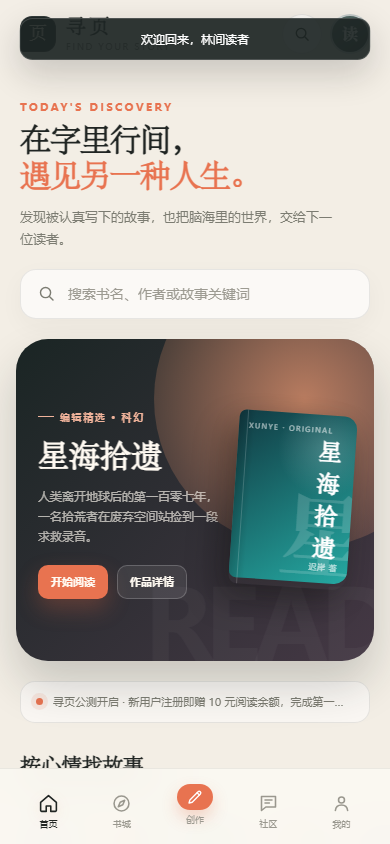
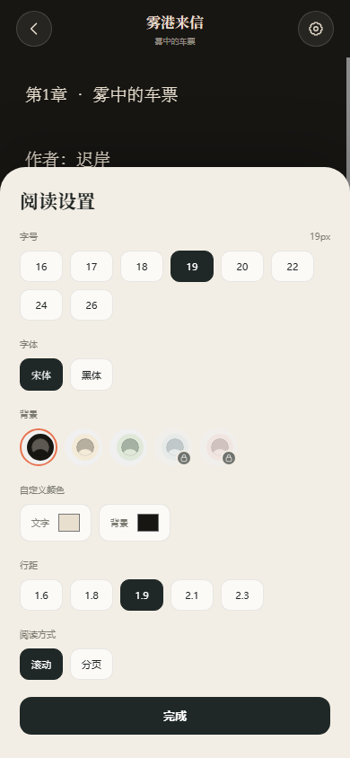
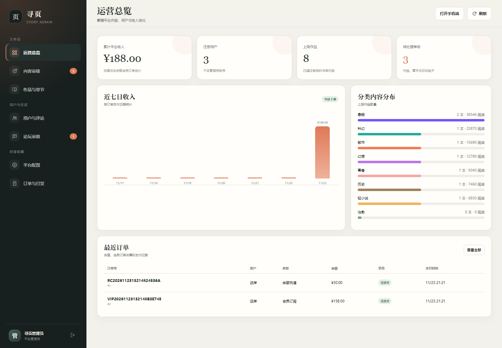
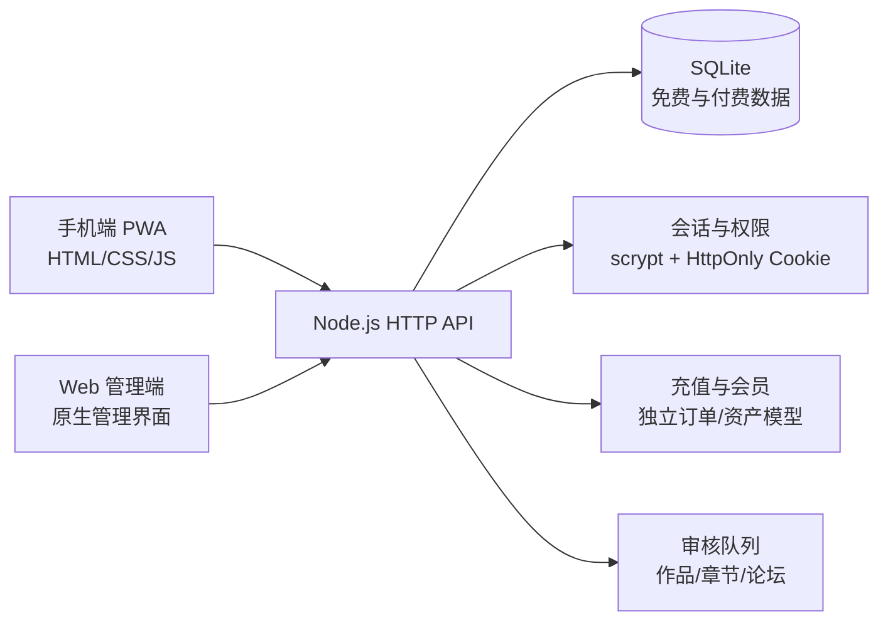

# 寻页 XUNYE

寻页是一套可直接运行的手机端小说阅读、创作与会员消费平台，同时包含 Web 管理后台。项目围绕「发现故事 → 阅读/购买 → 评论/打赏 → 作者创作 → 平台审核 → 会员与充值运营」形成完整业务闭环。

当前版本已完成从零搭建，不再只是一个 README。项目位于 `E:\大二\鼎甲杯\xunye`，对应 GitHub 仓库：[DpGhostCat/-](https://github.com/DpGhostCat/-)。

> 支付为比赛演示用的模拟支付，不会产生真实扣款。要正式上线，需接入微信支付/支付宝等持牌支付渠道。

## Windows 安装包

- 安装版：[Xunye-Windows-Setup.exe](https://github.com/DpGhostCat/-/releases/download/v1.0.0/Xunye-Windows-Setup.exe)
- 免安装版：[Xunye-Windows-x64.zip](https://github.com/DpGhostCat/-/releases/download/v1.0.0/Xunye-Windows-x64.zip)
- 校验值：[SHA256SUMS.txt](./release/SHA256SUMS.txt)
- GitHub 下载页：<https://github.com/DpGhostCat/-/releases/latest>

双击安装版后，程序会安装到当前用户目录并创建桌面快捷方式。桌面双击 `Xunye`，会以独立 Edge App 窗口启动，不需要命令行、Node.js、数据库或 Docker。

安装包内置 Node.js 运行时和全部前后端代码，首次启动自动生成 SQLite 数据库。默认端口为 `3777`，重复点击桌面图标会复用已启动的服务。安装目录中的 `Stop-Xunye.cmd` 可以关闭后台服务。

> 安装包当前未购买代码签名证书，Windows SmartScreen 可能显示“未知发布者”。可选择“更多信息 → 仍要运行”。正式比赛发布前建议进行代码签名。

## 界面预览

| 手机端首页 | 沉浸阅读 | 阅读设置 |
| --- | --- | --- |
|  |  |  |



## 1. 现在先做什么

如果你只想马上看到成品，按下面三步即可：

1. 安装 [Node.js](https://nodejs.org/) 24 或更高版本。Windows 下载 LTS 安装包后一直点“下一步”即可。
2. 双击项目根目录的 `start.bat`，或者在终端执行：

   ```powershell
   cd "E:\大二\鼎甲杯\xunye"
   node server\index.js
   ```

3. 浏览器打开：

   - 手机端：<http://localhost:3000>
   - Web 管理端：<http://localhost:3000/admin>

本项目没有第三方运行依赖，不需要 `npm install`，不需要安装 MySQL、Redis，也不需要 Docker 就能运行。SQLite 数据库会在第一次启动时自动创建并写入演示数据。当前这份本地工作区已经附带便携 Node 运行时，`start.bat` 会优先使用它；从 GitHub 重新克隆到其他电脑时，仍需安装 Node.js。

## 2. 演示账号

所有演示账号密码均为 `123456`。

| 角色 | 账号 | 可体验内容 |
| --- | --- | --- |
| 读者 | `reader` | 找书、阅读、收藏、购章、会员、充值、评论、论坛、打赏 |
| 作者 | `author` | 作者工作台、创建作品、保存章节草稿、提交审核、阅读收益 |
| 管理员 | `admin` | 作品/章节/论坛审核、用户、评论、配置、订单与运营数据 |

登录页也提供了一键登录按钮，适合比赛现场演示。

## 3. 已实现功能

### 手机端

- 首页发现：编辑精选、分类入口、热门排行、公告、会员入口。
- 书城搜索：书名、作者、简介关键词搜索；分类与热度/上新/更新/评分排序。
- 作品详情：作品信息、目录、书评、收藏、打赏、阅读进度。
- 沉浸阅读：上一章/下一章、阅读进度同步、字号、字体、行距、文字颜色、背景颜色、五套阅读主题、滚动/分页模式。
- 会员体系：月卡、季卡、年卡；有效期独立于余额；会员书库标识、会员免费章节、购书折扣、VIP 标识、会员专属阅读主题。
- 账户资产：阅读余额用于购章和打赏；充值有独立档位与赠送额度；会员订阅为独立订单。
- 章节购买：免费章节、余额购买、永久解锁、会员折扣、余额不足提示。
- 书架收藏：收藏状态与章节阅读进度同步。
- 评论互动：作品书评发布、展示、管理员隐藏。
- 论坛找书：找书、讨论、作者交流三类帖子；发帖审核、公开回复。
- 作者工作台：申请作者、创建作品、分章写作、草稿/提交审核、审核意见、作品数据、打赏收入。
- 个人中心：余额、会员状态、订单与余额流水、阅读偏好、退出登录。
- PWA：支持离线应用壳、添加到手机主屏幕、全屏启动。

### Web 管理端

- 运营总览：用户数、上架作品、待审数量、累计收入、近七日收入图表、分类内容分布、最近订单。
- 内容审核：作品审核、章节审核、论坛帖子审核；通过或填写原因驳回。
- 内容总表：查看全部作品和章节、状态、作者、价格、字数、阅读/收藏数据。
- 用户与评论：查看余额、会员有效期、账号状态；停用/恢复用户；隐藏/恢复评论。
- 论坛审核：查看待审正文并进行通过或驳回。
- 平台配置：内容分类、会员套餐、充值档位、平台公告；支持新增和编辑。
- 订单与打赏：充值订单、会员订单、作者打赏及 70% 分成记录。
- 权限隔离：普通用户无法访问管理 API，管理员会话失效后会自动回到登录页。

## 4. 业务流程说明

### 阅读与消费

1. 未登录用户可以浏览书城、作品详情和免费章节。
2. 付费章节返回 `402 CHAPTER_LOCKED`，只展示正文预览。
3. 登录后可使用余额购买章节，或使用会员免费权益阅读。
4. 会员购买章节时使用该会员套餐配置的折扣。
5. 阅读进度每章自动同步，书架显示最后阅读章节与百分比。

### 余额与会员为什么分开

- 余额是预付消费资产，只用于购买章节和打赏作品。
- 会员是带有效期的订阅权限，不会把余额转换为会员。
- 充值订单进入 `orders`，同时写入 `wallet_transactions`。
- 会员订阅只延长 `users.vip_expires_at` 并写会员订单，不扣阅读余额。
- 管理员分别配置充值档位和会员套餐，手机端读取同一份配置。

### 创作与审核

1. 读者在「创作」页申请成为作者。
2. 作者创建作品并保存章节草稿。
3. 作者提交作品或章节后，状态变为 `pending`。
4. 管理员在 Web 端审核：
   - 通过作品：作品上架，待审章节发布。
   - 通过章节：章节发布，关联的待审作品自动上架。
   - 驳回：保留审核意见，作者可查看并继续修改流程。
5. 已发布内容才会出现在读者书城和目录中。

## 5. 手机访问与安装

### 同一 Wi-Fi 访问

1. 手机和电脑连接同一 Wi-Fi。
2. Windows 终端执行 `ipconfig`，找到电脑的 IPv4 地址，例如 `192.168.1.23`。
3. 确保服务启动时 `HOST=0.0.0.0`，浏览器访问 `http://192.168.1.23:3000`。
4. 首次访问时，Windows 防火墙选择“允许 Node.js 访问专用网络”。

### 安装为手机 App

- Android Chrome/Edge：打开页面，菜单选择“添加到主屏幕”或“安装应用”。
- iPhone Safari：分享按钮 → “添加到主屏幕”。
- 手机浏览器只有在 HTTPS 或 `localhost` 下才允许 Service Worker。局域网 HTTP 可以演示功能，但要完整启用 PWA 离线与安装能力，需要 HTTPS 域名。
- 正式比赛演示建议先部署到 Render、Railway、云服务器或使用 Cloudflare Tunnel，再让手机通过 HTTPS 地址安装。

## 6. 开发与测试

```powershell
cd "E:\大二\鼎甲杯\xunye"

# 启动
node server\index.js

# 自动重启开发模式
node --watch server\index.js

# 语法检查
npm run check

# 自动化 API 测试
npm test
```

测试使用临时 SQLite 数据库，不会污染正式演示数据。当前 8 组自动化测试覆盖：

- 手机端/管理端静态页面与健康检查。
- 未登录付费章节拦截。
- 读者登录、购章、余额、书架进度。
- 充值与会员独立记账。
- 作者投稿、管理员审核、作品发布。
- 管理员角色权限。
- 评论隐藏。
- 用户注册与自定义阅读偏好。
- 会员专属阅读主题权限。

## 7. 技术架构



选择这套技术的原因：

- 单仓库、零第三方依赖、单命令启动，适合课程答辩和比赛现场。
- SQLite 由 Node.js 内置，不需要数据库账号、端口或驱动。
- 前后端仍完全分离，API 可无痛迁移到 PostgreSQL/MySQL。
- 手机端是可安装 PWA，界面按 390–520px 设计，后续可用 Capacitor 包装成 Android APK。

详细部署方法见 [DEPLOYMENT.md](./docs/DEPLOYMENT.md)，完整操作流程见 [USER-GUIDE.md](./docs/USER-GUIDE.md)，参考项目分析见 [REFERENCES.md](./docs/REFERENCES.md)。

## 8. 项目结构

```text
xunye/
├─ public/
│  ├─ index.html              手机端入口
│  ├─ app.js                  手机端页面、路由与交互
│  ├─ styles.css              手机端设计系统
│  ├─ admin.html              Web 管理端入口
│  ├─ admin.js                管理端页面、审核与配置
│  ├─ admin.css               管理端设计系统
│  ├─ manifest.webmanifest    PWA 配置
│  ├─ sw.js                   离线应用壳
│  └─ icon.svg                应用图标
├─ server/
│  ├─ index.js                启动入口
│  ├─ app.js                  HTTP 路由、认证、业务规则
│  └─ db.js                   数据表、初始演示数据、密码工具
├─ tests/
│  └─ api.test.js             端到端 API 自动化测试
├─ scripts/
│  └─ browser-smoke.js        无头浏览器页面检查
├─ data/                      运行时 SQLite 数据库
├─ docs/                      使用、部署与参考项目说明
├─ Dockerfile
├─ docker-compose.yml
└─ start.bat
```

## 9. 数据与安全说明

- 密码使用 Node.js `scrypt` 加盐哈希，不保存明文。
- 登录会话为随机令牌，数据库只保存令牌 SHA-256 哈希。
- 会话 Cookie 设置为 `HttpOnly`、`SameSite=Lax`；HTTPS 部署时设置 `COOKIE_SECURE=1`。
- 管理员、作者、读者权限均在服务端检查，不只依赖页面隐藏。
- 所有 SQL 使用参数绑定，用户内容在页面输出前进行 HTML 转义。
- 请求体限制 1 MB；登录失败有频率限制；响应包含 CSP、防点击劫持和 MIME 嗅探防护头。
- 金额全部以“分”为单位存储，避免浮点误差。

## 10. 下一步上线前需要准备

1. 注册域名并准备一台云服务器，或使用支持持久磁盘的 Node 平台。
2. 配置 HTTPS。
3. 把 SQLite 文件放在持久磁盘卷，并定期备份 `data/xunye.db`。
4. 接入真实短信、邮箱验证与实名认证。
5. 接入微信支付/支付宝，并把当前模拟支付回调替换为验签后的真实订单状态。
6. 增加内容安全审核、图片上传存储、防盗链和日志监控。
7. 如需上架应用商店，再用 Capacitor 将 PWA 包装为 Android/iOS 工程并配置签名。

